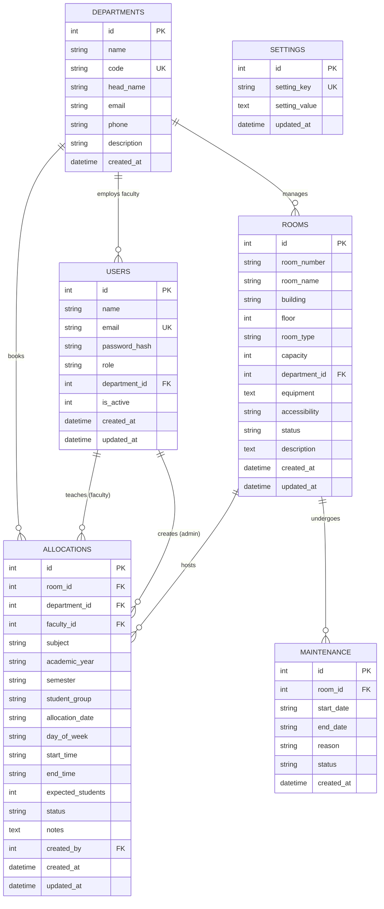

# Database Schema Specification

## Smart Room Allocation — College Classroom & Facility Management System

- **Database Engine:** SQLite 3
- **File Location:** `backend/data/rooms.db`
- **Execution Mode:** Write-Ahead Logging (`PRAGMA journal_mode = WAL;`)
- **Integrity Enforcement:** Foreign Keys Enabled (`PRAGMA foreign_keys = ON;`)

---

## 1. Entity Relationship (ER) Diagram



---

## 2. Table Specifications

### 2.1 `departments`
Stores academic divisions within the institution.

| Column | Data Type | Constraints | Description |
| :--- | :--- | :--- | :--- |
| `id` | `INTEGER` | `PRIMARY KEY AUTOINCREMENT` | Unique department identifier |
| `name` | `TEXT` | `NOT NULL` | Full department name (e.g. Computer Science & Engineering) |
| `code` | `TEXT` | `UNIQUE NOT NULL` | Short academic code (e.g. CSE, ECE, ME) |
| `head_name` | `TEXT` | `NULLABLE` | Name of the department chair/head |
| `email` | `TEXT` | `NULLABLE` | Official contact email |
| `phone` | `TEXT` | `NULLABLE` | Office contact phone |
| `description` | `TEXT` | `NULLABLE` | Brief overview of department scope |
| `created_at` | `DATETIME` | `DEFAULT CURRENT_TIMESTAMP` | Record creation timestamp |

---

### 2.2 `users`
Stores user accounts for authentication and authorization.

| Column | Data Type | Constraints | Description |
| :--- | :--- | :--- | :--- |
| `id` | `INTEGER` | `PRIMARY KEY AUTOINCREMENT` | Unique user identifier |
| `name` | `TEXT` | `NOT NULL` | Full name of the user |
| `email` | `TEXT` | `UNIQUE NOT NULL` | University login email |
| `password_hash` | `TEXT` | `NOT NULL` | Salted bcrypt hash of password |
| `role` | `TEXT` | `NOT NULL CHECK(role IN ('admin', 'faculty'))` | Role-based permission level |
| `department_id` | `INTEGER` | `FOREIGN KEY -> departments(id) ON DELETE SET NULL` | Assigned department |
| `is_active` | `INTEGER` | `DEFAULT 1` | Active status flag (1 = Active, 0 = Inactive) |
| `created_at` | `DATETIME` | `DEFAULT CURRENT_TIMESTAMP` | Account creation date |
| `updated_at` | `DATETIME` | `DEFAULT CURRENT_TIMESTAMP` | Last profile update date |

---

### 2.3 `rooms`
Stores details of classrooms, laboratories, and lecture halls.

| Column | Data Type | Constraints | Description |
| :--- | :--- | :--- | :--- |
| `id` | `INTEGER` | `PRIMARY KEY AUTOINCREMENT` | Unique room identifier |
| `room_number` | `TEXT` | `NOT NULL` | Display number (e.g. CR-101, LAB-201) |
| `room_name` | `TEXT` | `NOT NULL` | Descriptive name (e.g. Smart Lecture Hall) |
| `building` | `TEXT` | `NOT NULL` | Campus block / building name |
| `floor` | `INTEGER` | `NOT NULL` | Floor number |
| `room_type` | `TEXT` | `NOT NULL` | Classroom, Laboratory, Seminar Hall, Auditorium, etc. |
| `capacity` | `INTEGER` | `NOT NULL CHECK(capacity > 0)` | Maximum safe seating capacity |
| `department_id` | `INTEGER` | `FOREIGN KEY -> departments(id) ON DELETE SET NULL` | Optional affiliated department |
| `equipment` | `TEXT` | `DEFAULT '[]'` | JSON array of available equipment |
| `accessibility` | `TEXT` | `DEFAULT 'Standard'` | Accessibility features (Wheelchair, Elevator) |
| `status` | `TEXT` | `CHECK(status IN ('available', 'occupied', 'maintenance', 'inactive'))` | Current operational state |
| `description` | `TEXT` | `NULLABLE` | Facility notes |
| `created_at` | `DATETIME` | `DEFAULT CURRENT_TIMESTAMP` | Creation timestamp |
| `updated_at` | `DATETIME` | `DEFAULT CURRENT_TIMESTAMP` | Modification timestamp |

*Composite Unique Constraint:* `UNIQUE(room_number, building)` prevents duplicate room numbers in the same building.

---

### 2.4 `allocations`
Stores class schedules, lectures, lab sessions, and event bookings.

| Column | Data Type | Constraints | Description |
| :--- | :--- | :--- | :--- |
| `id` | `INTEGER` | `PRIMARY KEY AUTOINCREMENT` | Allocation identifier |
| `room_id` | `INTEGER` | `NOT NULL, FK -> rooms(id) ON DELETE RESTRICT` | Booked facility |
| `department_id` | `INTEGER` | `NOT NULL, FK -> departments(id) ON DELETE RESTRICT` | Booking department |
| `faculty_id` | `INTEGER` | `NOT NULL, FK -> users(id) ON DELETE RESTRICT` | Instructor in charge |
| `subject` | `TEXT` | `NOT NULL` | Course or event title |
| `academic_year` | `TEXT` | `NOT NULL` | Academic year (e.g. 2025-2026) |
| `semester` | `TEXT` | `NOT NULL` | Academic semester |
| `student_group` | `TEXT` | `NOT NULL` | Target class / section |
| `allocation_date`| `TEXT` | `NOT NULL` | Date in ISO format (`YYYY-MM-DD`) |
| `day_of_week` | `TEXT` | `NULLABLE` | Weekday name (Monday - Saturday) |
| `start_time` | `TEXT` | `NOT NULL` | Start time in 24-hr format (`HH:MM`) |
| `end_time` | `TEXT` | `NOT NULL` | End time in 24-hr format (`HH:MM`) |
| `expected_students`| `INTEGER` | `NOT NULL CHECK(expected_students > 0)` | Expected attendee count |
| `status` | `TEXT` | `CHECK(status IN ('confirmed', 'cancelled', 'completed'))` | Booking state |
| `notes` | `TEXT` | `NULLABLE` | Special instructions |
| `created_by` | `INTEGER` | `FK -> users(id) ON DELETE SET NULL` | Administrator user who created booking |
| `created_at` | `DATETIME` | `DEFAULT CURRENT_TIMESTAMP` | Booking timestamp |
| `updated_at` | `DATETIME` | `DEFAULT CURRENT_TIMESTAMP` | Update timestamp |

---

### 2.5 `maintenance`
Tracks scheduled repairs, HVAC servicing, and facility downtime.

| Column | Data Type | Constraints | Description |
| :--- | :--- | :--- | :--- |
| `id` | `INTEGER` | `PRIMARY KEY AUTOINCREMENT` | Maintenance order ID |
| `room_id` | `INTEGER` | `NOT NULL, FK -> rooms(id) ON DELETE CASCADE` | Facility under maintenance |
| `start_date` | `TEXT` | `NOT NULL` | Maintenance start date (`YYYY-MM-DD`) |
| `end_date` | `TEXT` | `NOT NULL` | Maintenance end date (`YYYY-MM-DD`) |
| `reason` | `TEXT` | `NOT NULL` | Description of maintenance work |
| `status` | `TEXT` | `CHECK(status IN ('scheduled', 'in_progress', 'completed'))` | Work order state |
| `created_at` | `DATETIME` | `DEFAULT CURRENT_TIMESTAMP` | Record creation date |

---

### 2.6 `settings`
Stores persistent global institution configuration in key-value format.

| Column | Data Type | Constraints | Description |
| :--- | :--- | :--- | :--- |
| `id` | `INTEGER` | `PRIMARY KEY AUTOINCREMENT` | Setting row ID |
| `setting_key` | `TEXT` | `UNIQUE NOT NULL` | Unique setting key (e.g. `institution_name`) |
| `setting_value`| `TEXT` | `NOT NULL` | Value (scalar or JSON string) |
| `updated_at` | `DATETIME` | `DEFAULT CURRENT_TIMESTAMP` | Last updated timestamp |

---

## 3. Database Indexes

To ensure high performance when querying large scheduling datasets, the schema includes targeted B-Tree indexes:

```sql
CREATE INDEX idx_allocations_room_date ON allocations(room_id, allocation_date, status);
CREATE INDEX idx_allocations_faculty_date ON allocations(faculty_id, allocation_date, status);
CREATE INDEX idx_allocations_dept_date ON allocations(department_id, allocation_date);
CREATE INDEX idx_rooms_building ON rooms(building, room_type);
CREATE INDEX idx_maintenance_room ON maintenance(room_id, start_date, end_date);
```
